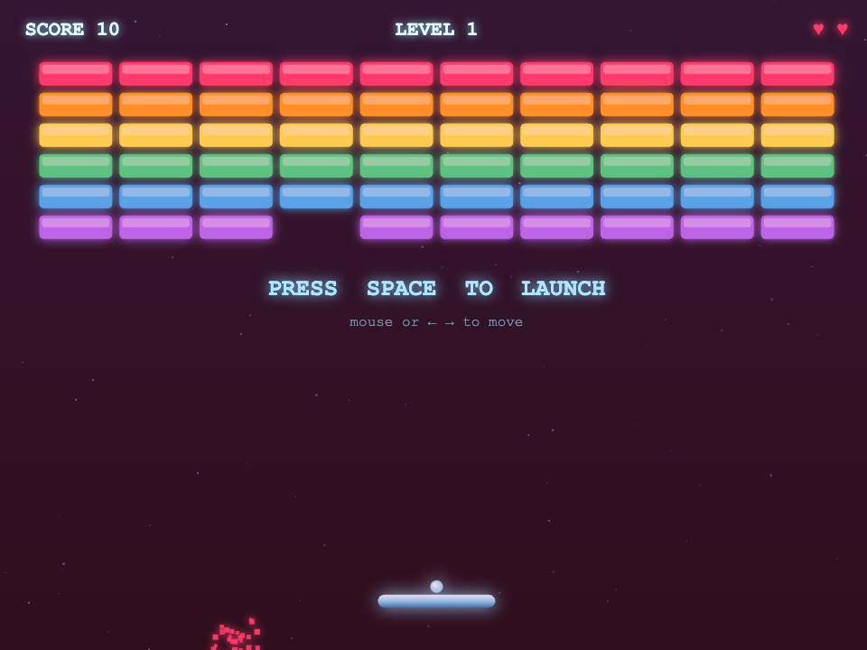
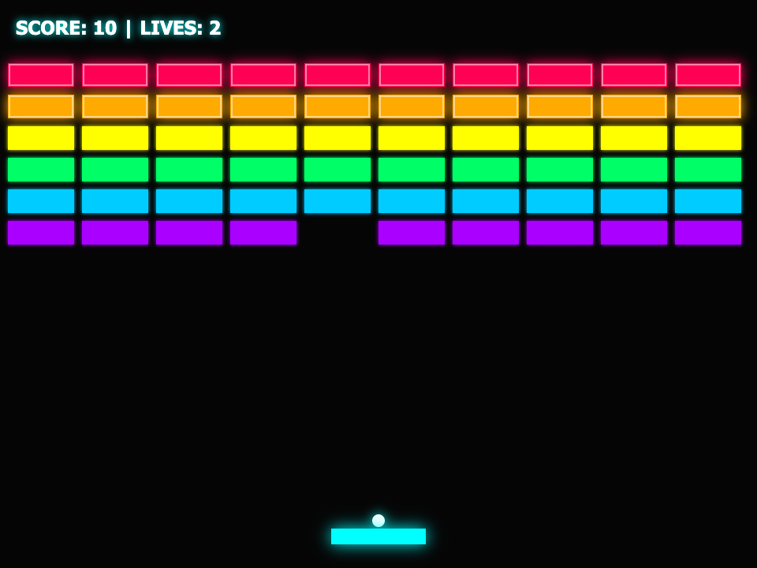

# Agent-12

Agent-12 answers one question: which model, running on a machine you can buy,
can actually be your coding agent? It makes a model do 20 real agent tasks
(12 easy, 8 hard), each in a fresh sandbox directory, and then checks the
files the model left behind. What the model says it did is never read.

The tasks, the judges, the runner and the scores are all in the
[GitHub repo](https://github.com/nicedreamzapp/agent12). The scoreboard is
rendered from the JSON files in `results/` by `build_site.py`.

## Who it is for

- People choosing a local model to run as an agent on Apple silicon or other
  desk-sized hardware.
- People building agent harnesses who want to measure their harness against
  the same tasks and judges (the `command` adapter runs any agent CLI).
- Anyone who wants to reproduce a score on their own machine and report it
  ([issue #5](https://github.com/nicedreamzapp/agent12/issues/5)).

## Current scores

These are the headline rows from the README, and each number matches the
result file named in `site/meta.json`. Time is total wall-clock seconds for
the suite, not counting model load.

| Model | Easy (12) | Hard (8) |
|---|---|---|
| Qwen3.6-35B-A3B (MLX 8-bit) | 12/12 in 64.2s | 8/8 in 125.2s |
| Qwen3-Coder-30B-A3B (MLX 8-bit) | 12/12 in 42.6s | 7/8 in 391.5s |
| Gemma 4 31B (MLX 4-bit) | 11/12 in 92.1s | 8/8 in 347.9s |
| Qwen3.8-27B (MLX 8-bit) + DFlash 2 drafter | 12/12 in 122.0s | 7/8 in 401.4s |
| DeepSeek V4 Flash (2-bit, ds4.c) | 12/12 in 203.2s | 8/8 in 550.8s |
| Claude Sonnet 5 (cloud reference, same engine) | 12/12 in 122.0s | 8/8 in 131.0s |

Local rows ran on one Apple-silicon Mac with 128 GB of unified memory.
`site/meta.json` labels it "Apple M5, 128 GB unified memory"; the writeups
say "M5 Max". **TODO-VERIFY** the exact chip name.

All of these scores come from Agent-12's own reference harness (Anvil), not
from Claude Code. The same model inside a different harness scores and times
differently; see [How it works](how-it-works.md#the-harness-is-a-variable).

The full table, with tokens per second and a vendor-reported section, is the
[live leaderboard](https://nicedreamzapp.github.io/agent12/leaderboard/)
(**TODO-VERIFY**: this path is where the docs workflow publishes the board;
until the Pages source is switched, the board is at the site root).

## What a judged run looks like

A side bench asks a model for one self-contained HTML file, then a script
loads it in headless Brave, takes screenshots, and drives it with synthetic
mouse and keyboard input. These are frames the judge captured on 2026-09-19.

<figure markdown="span">
  { width="460" loading=lazy }
  <figcaption>Breakout written by Qwen3.8-27B (8-bit, DFlash 2 drafter). Passed.</figcaption>
</figure>

<figure markdown="span">
  { width="460" loading=lazy }
  <figcaption>Breakout written by Gemma 4 31B (bf16). Passed.</figcaption>
</figure>

<figure markdown="span">
  { width="360" loading=lazy }
  <figcaption>The spinning-ball task, Gemma 4 31B (bf16). Passed.</figcaption>
</figure>

The full write-up of that run is
[`writeups/visual_showdown_2026-09-19.md`](https://github.com/nicedreamzapp/agent12/blob/main/writeups/visual_showdown_2026-09-19.md).

## Three rules the benchmark keeps

1. **Every judge is validated before it judges.** `validate_judges.py` runs a
   known-good solution (must pass) and a plausible known-bad one (must fail)
   against every task, plus the known-good answer again with a UTF-8 BOM
   added. Any mismatch exits non-zero.
2. **One variable moves per comparison.** Temperature 0, fixed token and step
   caps per suite, a fresh sandbox and a fresh conversation per task.
3. **The filesystem is the judge.** Judges read the files and run the code in
   a fresh subprocess. Tasks that ship a test file pin its SHA-256, so editing
   the test scores zero.

## Next steps

- [Install](install.md) what you need for the part you want to run.
- [Quickstart](quickstart.md): validate the judges and score your own agent CLI.
- [Configuration](configuration.md): every flag, environment variable and config field.
